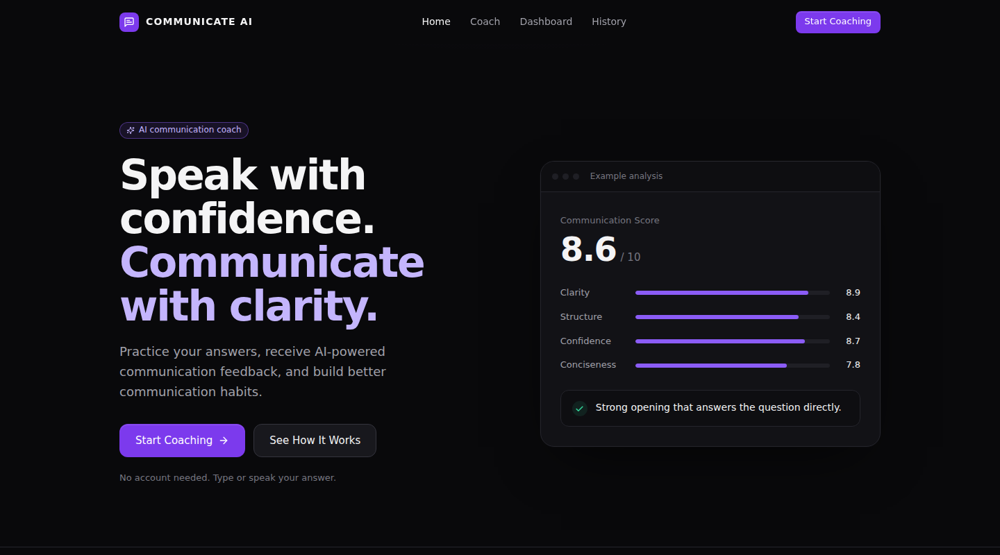
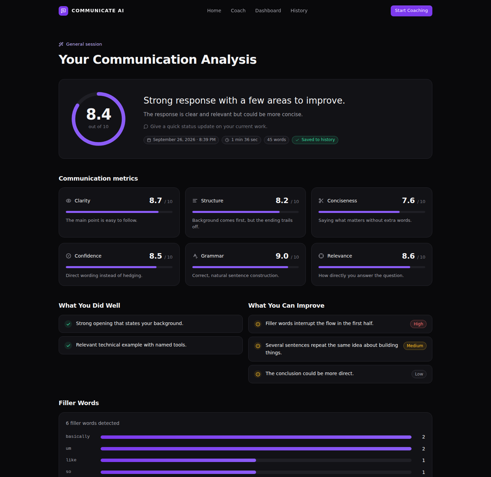

# Communicate AI

**AI-powered communication and interview coaching.** Practice an answer to an interview, presentation or everyday question, and get structured feedback on clarity, structure, conciseness, confidence of wording, grammar, relevance and filler words, plus an improved version of *your own* answer. Every session is saved, so you can track progress and spot recurring habits over time.

> Practice → Analyze → Understand weaknesses → Improve → Practice again → Track progress



---

## Features

- **Three coaching modes:** Interview, Presentation and General, each with its own suggested questions (or bring your own question).
- **Text or voice input:** voice uses the browser's Web Speech API, with pause, stop and cancel. It's always optional, and unsupported browsers get a clear message and fall back to typing.
- **Structured AI analysis:** six scores (0–10), each with a one-line explanation, plus strengths, prioritized improvements (low, medium or high) and a summary.
- **Deterministic filler-word detection:** word-boundary aware ("actual" ≠ "actually", "also" ≠ "so"), with context rules so "I'd *like* to" and "tools *like* Docker" aren't counted.
- **AI-improved answer:** restructures what you said without inventing projects, companies or results. You can copy it, retry, or load it back into the editor.
- **Side-by-side comparison:** fillers are highlighted, with word count, sentence length and filler count shown before and after.
- **Progress dashboard:** total sessions, average, best and recent improvement, plus trend charts (overall, clarity, confidence, conciseness). Every number is computed from stored sessions.
- **Communication Pattern Detector:** finds habits that recur across recent sessions and sets your next practice goal. If the AI is unavailable, it falls back to statistics only.
- **History:** filter by mode, open the full analysis, delete with a confirmation dialog.
- **Production details:** validated AI output (repair → retry → controlled error), friendly error messages, skeleton loaders, empty states, keyboard navigation, reduced-motion support, and responsive layouts from 320 px up.



<sub>Screenshots use sample sessions.</sub>

---

## Architecture

```
┌──────────────┐   JSON/HTTP   ┌────────────────────────────────────────────┐
│ React (Vite) │ ────────────▶ │ FastAPI                                    │
│              │               │  routes/  → validation (Pydantic)          │
│ pages/       │               │  services/analysis_service                 │
│ components/  │ ◀──────────── │    ├─ speech_service (fillers, duration)   │
│ hooks/       │               │    ├─ ai_service (AIService → Gemini)      │
│ services/api │               │    └─ repair JSON → validate → retry once  │
└──────────────┘               │  services/pattern_service                  │
                               │  SQLAlchemy → SQLite (dev) / Postgres      │
                               └────────────────────────────────────────────┘
```

**Request flow for `POST /api/analyze`:**

1. Pydantic validates mode, question and answer (length limits, at least 3 words).
2. `speech_service` counts filler words and estimates speaking time in code, so counts are exact and reproducible.
3. `analysis_service` builds the prompt (the system prompt enforces objective, observable-only feedback) and calls the provider through the `AIService` abstraction.
4. The raw output is repaired (code fences, surrounding prose, trailing commas), normalized, and validated against `AIAnalysis`. If it's invalid, the model is retried once with the validation error. If it's still invalid, the API returns a controlled `502`.
5. The session is stored and returned. The frontend navigates to `/results/:id`.

**Design decisions:**

- **The API key never leaves the backend.** It's sent as the `x-goog-api-key` header, not in the URL, so it can't leak into logs.
- **Filler counts don't come from the LLM.** Models are bad at counting, so the code counts and the model gets the numbers as facts.
- **Adding a provider** means subclassing `AIService`, implementing `generate_json()`, and registering it in `_PROVIDERS`.
- **Errors** map to typed `AIError` subclasses (config, auth, timeout, unavailable, bad response), each with a safe `user_message`. A global handler guarantees that no stack traces reach clients.

---

## Tech stack

| Layer | Tech |
| --- | --- |
| Frontend | React 18, Vite, React Router, Framer Motion, Recharts, lucide-react, plain CSS with design tokens |
| Backend | Python 3.11, FastAPI, Pydantic v2, pydantic-settings, SQLAlchemy 2, httpx (async) |
| AI | Google Gemini (`generateContent`, JSON response mode) |
| Database | SQLite locally, PostgreSQL in production |
| Tooling | pytest, GitHub Actions, Render Blueprint |

---

## Project structure

```
communication-coach/
├── backend/
│   ├── app/
│   │   ├── main.py              # app, CORS, error handlers, routers
│   │   ├── config.py            # env-based settings
│   │   ├── database.py          # engine, session, init_db
│   │   ├── models/session.py    # PracticeSession ORM model
│   │   ├── schemas/             # analysis.py, session.py (Pydantic)
│   │   ├── routes/              # analysis, sessions, dashboard, patterns
│   │   └── services/            # ai_service, analysis_service, pattern_service, speech_service
│   ├── tests/                   # pytest (fake AI provider, temp SQLite)
│   ├── requirements.txt
│   ├── requirements-dev.txt
│   └── .env.example
├── frontend/
│   ├── src/
│   │   ├── components/          # Navbar, Button, ScoreCard, MetricCard, FeedbackCard, FillerWordChart,
│   │   │                        # ProgressChart, SessionCard, LoadingAnalysis, EmptyState, ErrorState, Modal, …
│   │   ├── pages/               # Landing, Coach, Results, Dashboard, History, SessionDetails, NotFound
│   │   ├── hooks/               # useSpeech, useAnalysis, useFetch
│   │   ├── services/api.js      # the only place that knows the API URL
│   │   ├── utils/               # formatDate, formatDuration, text
│   │   └── data/coaching.js     # modes, questions, metric metadata
│   ├── package.json
│   └── .env.example
├── .github/workflows/ci.yml
├── render.yaml
└── README.md
```

---

## Running locally

**Prerequisites:** Python 3.10+, Node 18+, and a Gemini API key (free from [Google AI Studio](https://aistudio.google.com/app/apikey)).

### 1. Backend

```bash
cd backend
python -m venv venv
# Windows
venv\Scripts\activate
# macOS / Linux
source venv/bin/activate

pip install -r requirements.txt
cp .env.example .env        # Windows: copy .env.example .env
# edit .env and set GEMINI_API_KEY

uvicorn app.main:app --reload
```

The API runs at http://127.0.0.1:8000, with interactive docs at http://127.0.0.1:8000/docs. The SQLite database is created automatically on first start.

### 2. Frontend

```bash
cd frontend
cp .env.example .env        # VITE_API_URL=http://127.0.0.1:8000
npm install
npm run dev
```

Open http://localhost:5173.

---

## Environment variables

**`backend/.env`**

| Variable | Default | Description |
| --- | --- | --- |
| `AI_PROVIDER` | `gemini` | AI provider key registered in `ai_service.py` |
| `GEMINI_API_KEY` | – | **Required** for analysis |
| `GEMINI_MODEL` | `gemini-2.5-flash` | Any Gemini model that supports JSON output |
| `AI_TIMEOUT_SECONDS` | `45` | Timeout for each AI request |
| `DATABASE_URL` | `sqlite:///./communication_coach.db` | `postgres://…` URLs are normalized automatically |
| `CORS_ORIGINS` | `http://localhost:5173,http://127.0.0.1:5173` | Comma-separated frontend origins |
| `MAX_QUESTION_CHARS` / `MAX_ANSWER_CHARS` | `500` / `5000` | Input limits |

**`frontend/.env`**

| Variable | Description |
| --- | --- |
| `VITE_API_URL` | Backend base URL, with no trailing slash |

`.env` files are git-ignored. Only the `.env.example` files are committed.

---

## API

All errors return `{"detail": "<friendly message>", "code": "<ErrorType>"}`.

| Method | Path | Description |
| --- | --- | --- |
| GET | `/api/health` | `{"status": "ok"}` |
| POST | `/api/analyze` | Analyze and save a response |
| GET | `/api/sessions?limit=&offset=` | Session summaries, newest first |
| GET | `/api/sessions/{id}` | Full session with analysis |
| DELETE | `/api/sessions/{id}` | Delete a session (`204`) |
| GET | `/api/dashboard` | Totals, average, best, recent improvement, trend, metric averages |
| POST | `/api/patterns` | Recurring patterns + next practice goal (needs 2+ sessions) |

**`POST /api/analyze`**

```json
{
  "mode": "interview",
  "question": "Tell me about yourself.",
  "answer": "I am a computer science student and I have worked on several projects...",
  "recorded_seconds": 48
}
```

`recorded_seconds` is optional. It's sent when the answer was dictated. Otherwise duration is estimated at 140 words per minute.

Response (`201`):

```json
{
  "id": 12,
  "mode": "interview",
  "question": "Tell me about yourself.",
  "answer": "...",
  "overall_score": 8.6,
  "clarity_score": 8.9, "structure_score": 8.4, "conciseness_score": 7.8,
  "confidence_score": 8.7, "grammar_score": 9.1, "relevance_score": 8.8,
  "duration_seconds": 78,
  "filler_words": { "um": 3, "basically": 2 },
  "score_explanations": { "clarity": "...", "structure": "...", "...": "..." },
  "strengths": ["Strong opening", "Relevant technical example"],
  "improvements": [{ "text": "Make the conclusion more direct.", "severity": "medium" }],
  "summary": "The response is clear and relevant but could be more concise.",
  "improved_answer": "...",
  "created_at": "2026-09-27T10:15:00Z"
}
```

| Status | When |
| --- | --- |
| `422` | Empty or too-long input, invalid mode |
| `503` | Missing or invalid API key, provider unavailable or rate-limited |
| `504` | AI timeout |
| `502` | AI output still invalid after repair and one retry |

---

## Testing

```bash
cd backend
pip install -r requirements-dev.txt
pytest -q
```

The tests use a fake `AIService` and a temporary SQLite database. They cover:

- Filler-word boundaries and context rules
- JSON repair, retry, and the controlled error path
- Missing-key and validation errors
- Session CRUD and 404s
- Dashboard math
- Pattern detection, both AI and statistical fallback

GitHub Actions runs the backend tests and a production frontend build on every push.

**Manual checklist:**

- Analyze with voice and without it.
- Refresh `/results/:id` and `/history/:id`.
- Stop the backend and confirm the friendly network error.
- Remove `GEMINI_API_KEY` and confirm the configuration message.
- Delete a session and confirm the dashboard updates.
- Test at 320 px width.

---

## Deployment (Render)

`render.yaml` provisions the API, the static frontend and a Postgres database:

1. Push this repo to GitHub.
2. In Render, go to **New → Blueprint** and select the repo.
3. When prompted, set:
   - `GEMINI_API_KEY`: your key
   - `VITE_API_URL`: the API service URL, e.g. `https://communicate-ai-api.onrender.com`
   - `CORS_ORIGINS`: the frontend URL, e.g. `https://communicate-ai.onrender.com`
4. Deploy. If you only learn the final URLs after the first deploy, update the two variables and redeploy the frontend, since Vite bakes `VITE_API_URL` in at build time.

Notes:

- Free web services sleep when idle, so the first request can take up to about a minute.
- Check Render's current free-tier limits for Postgres. For long-lived data, use a paid database or any external Postgres by setting `DATABASE_URL`.
- The frontend also works on Vercel or Netlify (`frontend/vercel.json` handles SPA routing). Set the root directory to `frontend` and add `VITE_API_URL`.

---

## Troubleshooting

| Symptom | Fix |
| --- | --- |
| "We couldn't reach the server" | Make sure the backend is running and that `VITE_API_URL` matches it. Restart `npm run dev` after editing `.env`. |
| CORS error in the browser console | Add the exact frontend origin (scheme + host + port) to `CORS_ORIGINS` and restart the API. |
| "The AI service isn't configured" | Set `GEMINI_API_KEY` in `backend/.env` and restart uvicorn. |
| "The AI provider rejected the API key" | Regenerate the key in Google AI Studio. |
| "temporarily unavailable" | Provider rate limit or outage. Wait and retry, or change `GEMINI_MODEL`. |
| Voice button missing | The browser lacks the Web Speech API (e.g. Firefox). Typing always works. Chrome and Edge are supported. |
| Microphone blocked | Allow microphone access for the site. Speech recognition requires HTTPS or `localhost`. |
| Deep links 404 in production | Configure the host to rewrite all paths to `index.html`. This is already done for Render and Vercel. |

---

## Responsible AI

The system prompt limits the model to observable communication traits. It forbids:

- Inferences about intelligence, personality, emotions or mental health
- Inventing facts in the improved answer

Feedback is phrased neutrally, and severity labels describe impact, not judgment.

## Future improvements

- User accounts and per-user history
- Audio upload with server-side transcription and pacing analysis (words per minute, pauses)
- Role-specific question banks and mock interview sessions
- Streaming analysis responses
- Additional AI providers
- Export progress reports as PDF
